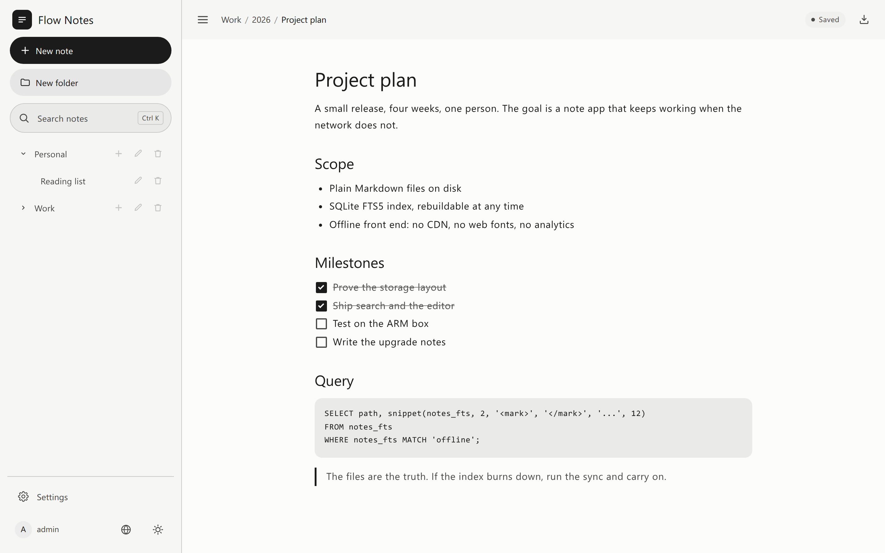
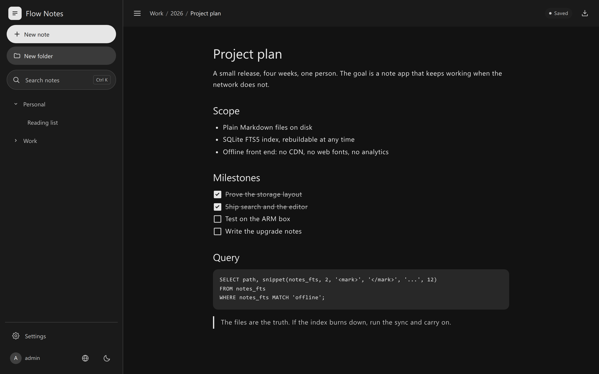
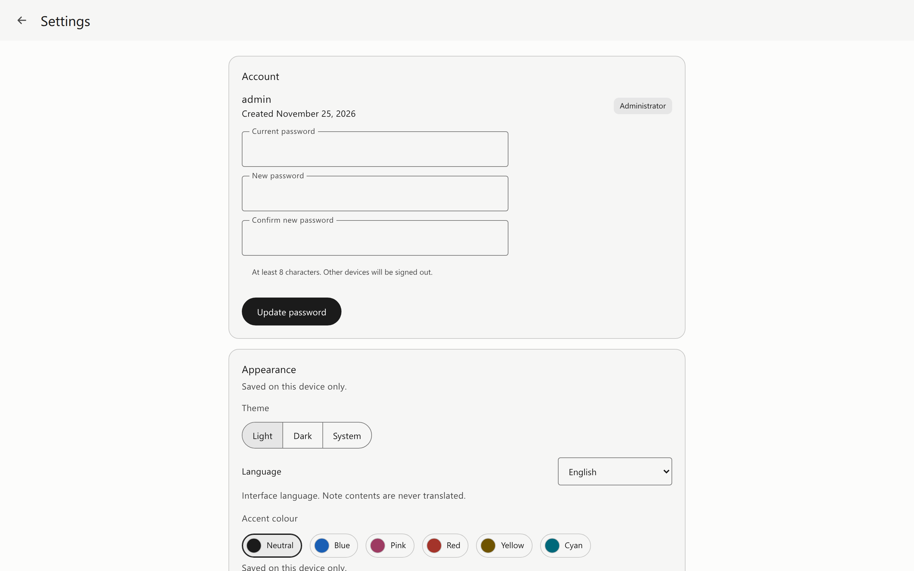
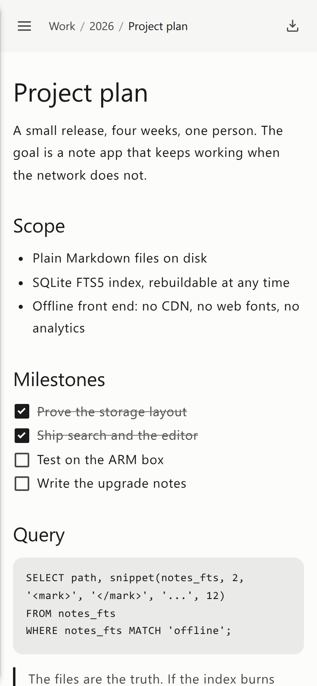

# Flow Notes

A small, self-hosted note server with an offline-first browser client. Notes are plain
Markdown files under `data/notes/<account>/`; the folders on disk are the sidebar, and SQLite
only holds the accounts and a search index that can be rebuilt at any time. Nothing is fetched
from the network at runtime — no CDN, no web fonts, no remote icons.

## Features

- **Plain files.** One Markdown file per note, one folder per sidebar folder. Edit them with
  any editor; the tree and the index catch up.
- **Multi-user.** Every account owns `data/notes/<name>/` and `data/uploads/<name>/`; the index
  is isolated by owner. Administrators create, disable and delete accounts, and reset passwords.
- **Editor.** Tiptap with Markdown round-tripping: headings, lists, task lists, code blocks,
  quotes, dividers, bold/italic/strikethrough/inline code, images. `/` opens the command menu,
  `# ` / `- ` / `1. ` / `> ` / `---` and a fence (` ``` ` + space) convert as you type; pasted
  screenshots are uploaded automatically, and edits autosave 600 ms after the last keystroke.
- **Search.** SQLite FTS5 with highlighted excerpts, plus a substring fallback for CJK queries.
- **Interface.** Material 3 in seven languages (English, Traditional and Simplified Chinese,
  Arabic with full RTL, French, Russian, Spanish), light/dark/system themes and six accent tones.
- **No default account.** The first visit is a setup wizard; an optional token keeps strangers
  from claiming the instance.
- **First note.** A new account starts with a welcome note in the language of the first sign-in
  (English, Chinese, Arabic, French, Russian or Spanish), so nothing opens in a language the
  person may not read.

## Screenshots

| Editor, light theme | Editor, dark theme |
| --- | --- |
|  |  |

| Settings | Phone-sized layout |
| --- | --- |
|  |  |

## Requirements

- Docker with Compose (recommended), or Python 3.11+ for a manual install.
- A directory for `data/`; the image itself is about 170 MB.

## Quick start

```bash
mkdir -p data
docker compose up -d --build
```

Open `http://<host>:8000`. The first page is `/setup`; create the administrator there, then add
other accounts from **Settings → Users**. The service speaks plain HTTP; if you need HTTPS,
[DOCS.md](DOCS.md#tls-and-reverse-proxies) has a Caddy and an nginx example.

Prefer the published image:

```bash
docker compose -f docker-compose.ghcr.yml up -d
```

`ghcr.io/noelbennettz/flownotes:latest` is built by this repository's workflow. The package is
public, so `docker pull` works anonymously — no `docker login` needed.

Without Docker:

```bash
python3 -m venv .venv && . .venv/bin/activate
pip install -r requirements.txt
FLOWNOTES_DATA="$PWD/data" uvicorn app.main:app --host 0.0.0.0 --port 8000
```

The committed `static/vendor/editor.bundle.js` means Node is only needed when you change the
editor dependencies.

The container starts its entrypoint as root only to chown `./data` to
`FLOWNOTES_UID`/`FLOWNOTES_GID` (default `1000:1000`) and then runs uvicorn as that user, so
`mkdir -p data` is optional and the notes never belong to root. Keep `user:` out of the Compose
service — it would skip the chown and bring back the old permission error.

On rootless Docker the container uid maps to a subuid, so the default `1000:1000` writes files
your host account cannot read. Put `FLOWNOTES_UID=0` and `FLOWNOTES_GID=0` in a `.env` next to
the compose file (uid 0 maps back to you). [DOCS.md](DOCS.md#troubleshooting) has the details.

## Data and backups

```
data/
├── notes/<account>/…          # Markdown; folders are the sidebar
├── uploads/<account>/…        # images from paste or upload
├── index.db                   # accounts + FTS5 index (rebuildable)
├── .session-secret            # cookie signing key (0600)
└── trash/<account>-<stamp>/   # files from deleted accounts
```

Stop the container and copy `data/` for a backup; notes can also be copied while it runs, since
every note write replaces the file atomically (uploads are written in one go). The index is derived data, but it also holds the
accounts — export the notes before deleting it.

## Forgot the admin password

```bash
docker compose exec -it flownotes python -m app.cli list
docker compose exec -it flownotes python -m app.cli passwd admin
```

The CLI writes the database directly, so the change applies immediately and the account's other
sessions are invalidated. `python -m app.cli create <name>` works only while no account exists.

## Images and CI

`.github/workflows/docker.yml` builds `linux/amd64` and `linux/arm64` with Buildx on every push
to `master`/`main` (and for `v*` tags), pushes to GHCR, then boots the image and runs an
end-to-end smoke test (setup, login, write, search, files on disk). Pull requests build without
pushing. Tags: branch name, `sha-<commit>`, `v1.2.3` and `1.2`, plus `latest` on the default
branch. Set the repository variable `DOCKER_PLATFORMS=linux/amd64` to skip the arm64 build.

The same workflow keeps the Actions tab small: `scripts/prune-runs.sh 3` deletes every older run
of the workflow, at the start of the build and again in a `prune` job that runs even when an
earlier job failed.

Offline check (should print nothing):

```bash
grep -rn -e 'http://' -e 'https://' app static/app.js static/editor.js static/settings.js \
  static/ui.js static/i18n.js static/vendor/app.css Dockerfile docker-compose.yml requirements.txt
```

## Security

Report a vulnerability through GitHub's private reporting: **Security → Report a vulnerability**
on <https://github.com/noelbennettz/flownotes>. If that form is unavailable, open an issue titled
`Security contact request` that says nothing about the technical details. [SECURITY.md](SECURITY.md)
lists the supported versions, what is in and out of scope, and what to expect.

The service speaks plain HTTP: put it behind a TLS terminator before exposing it. The session
cookie is `HttpOnly`, `SameSite=Lax` and deliberately not `Secure`, so a plain-HTTP LAN address
can sign in. See the [security notes](DOCS.md#security-notes) for the rate limit, the path rules
and the upload allow-list.

## Documentation

| File | Contents |
| --- | --- |
| [DOCS.md](DOCS.md) | Installation detail, data layout, index internals, the API reference, operations, TLS and reverse proxies, troubleshooting, development. |
| [CONTRIBUTING.md](CONTRIBUTING.md) | Repository layout, how to build and run the checks, house rules, commit style. |
| [SECURITY.md](SECURITY.md) | Supported versions, how to report, scope. |
| [THIRD_PARTY_NOTICES.md](THIRD_PARTY_NOTICES.md) | Licence of every Python package in the image and every library inside the editor bundle. |
| [docker-compose.example.yml](docker-compose.example.yml) | Every port, volume and variable, commented in place. |
| [docker-compose.ghcr.yml](docker-compose.ghcr.yml) | The same deployment using the published image. |

## Contributing

Patches are welcome. [CONTRIBUTING.md](CONTRIBUTING.md) covers the build, the checks to run
before opening a pull request, and the two rules that matter most: comments and backend messages
are English, and user-visible strings live only in `static/i18n.js`.

## Licence

MIT; see [LICENSE](LICENSE). Third-party components keep their own licences and are listed in
[THIRD_PARTY_NOTICES.md](THIRD_PARTY_NOTICES.md).
